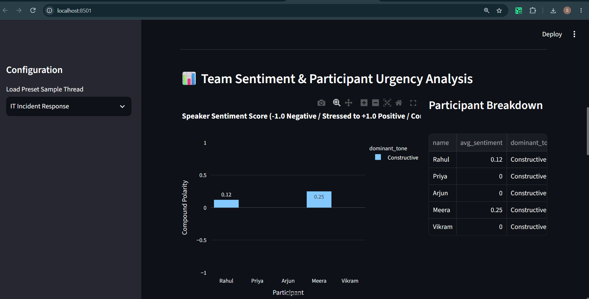
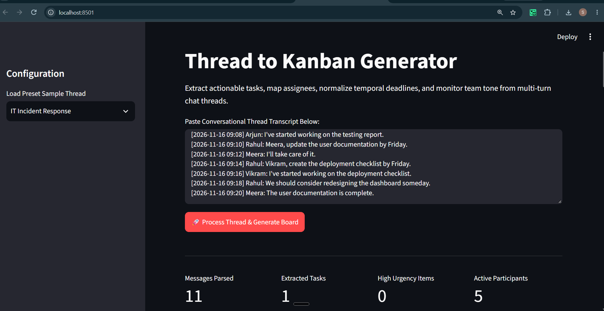
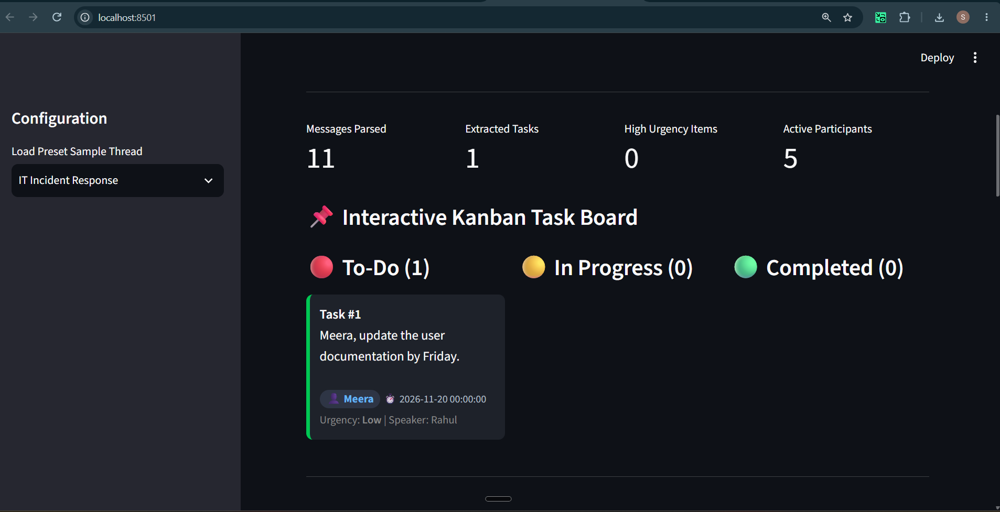

# Thread2Task

**Automated Action-Item Extraction and Interactive Kanban Board**

Thread2Task is an NLP-based application that transforms team conversation transcripts into structured, actionable tasks and presents them on an interactive Kanban board.

The system combines a fine-tuned DistilBERT action-item classifier with discourse analysis, contextual task consolidation, attribute extraction, and task-state tracking.

## Application Screenshots

### 1. Interactive Kanban Board


### 2. Conversation Input


### 3. Extracted Action Items


## Sample NLP Output

Thread2Task converts unstructured team conversations into structured task records containing descriptions, assignees, deadlines, statuses, and source-message references.

The application also supports exporting the extracted tasks as a JSON file for further analysis or integration with other systems.

**[View Sample JSON Output](examples/sample_output.json)**

The sample output was generated using the demonstration conversation shown in the application screenshots.

## Features

- Detect actionable messages from conversation transcripts.
- Extract task descriptions, assignees, and deadlines.
- Interpret contextual commitments and follow-up messages.
- Track task states, including TODO, IN_PROGRESS, DONE, and CANCELLED.
- Display extracted tasks in an interactive Streamlit Kanban interface.
- Support rule-based conversation analysis alongside transformer-based classification.

## Technology Stack

- **Language:** Python
- **Machine Learning:** PyTorch, Hugging Face Transformers, DistilBERT
- **NLP:** spaCy, rule-based discourse and context analysis
- **Application:** Streamlit
- **Testing:** pytest

## Project Workflow

1. **Transcript Parsing:** Convert raw conversation transcripts into structured messages.
2. **Action Classification:** Use the fine-tuned DistilBERT classifier to identify potential action items.
3. **Discourse Analysis:** Identify requests, assignments, commitments, and suggestions.
4. **Contextual Consolidation:** Associate related messages and commitments with task candidates.
5. **Attribute Extraction:** Extract descriptions, assignees, and deadlines.
6. **Task-State Tracking:** Interpret updates and adjust the status of existing tasks.
7. **Kanban Visualization:** Present structured tasks in an interactive interface.

## Installation

Clone the repository:

```bash
git clone https://github.com/YOUR_USERNAME/Thread2Task.git
cd Thread2Task
```

Create a virtual environment:

```bash
python -m venv venv
```

Activate it on Windows:

```powershell
.\venv\Scripts\Activate.ps1
```

Install the dependencies:

```bash
pip install -r requirements.txt
```

## Model Checkpoint

The trained DistilBERT model weights are excluded from this repository because of their size.

The application expects the classifier files under:

```text
models/
└── action_classifier/
    ├── config.json
    ├── model.safetensors
    ├── tokenizer.json
    └── tokenizer_config.json
```

To run inference, provide a compatible trained checkpoint at this location. Alternatively, train the classifier using the scripts in `training/` and the required training dataset.

## Running the Application

Start the Streamlit application:

```bash
streamlit run app.py
```

Run the standalone NLP pipeline:

```bash
python run_pipeline.py
```

## Testing

Run the regression tests:

```bash
python -m pytest tests/ -q
```

The latest local regression run passed **56 tests**.

## Evaluation

An initial end-to-end evaluation was conducted using 20 synthetic conversation threads with AI-drafted reference annotations.

The original benchmark measured task precision, recall, task-level F1, and attribute extraction accuracy.

**Important:** The reference annotations require independent human verification. The benchmark has been used during development and should not be interpreted as an unbiased final test set.

The evaluation scripts and supporting files are included in the repository.

## Current Limitations

- The custom-trained model checkpoint is not distributed with the source repository.
- Some indirect requests and contextual references remain difficult to resolve.
- Task deduplication and complex task-state updates require further improvement.
- Performance on independent, real-world conversation datasets has not yet been established.
- The current interface is intended as a local application.

## Project Status

Thread2Task is a functional academic NLP project with a working local Streamlit interface and an ongoing evaluation and error-analysis workflow.

## License

No open-source license has been assigned yet.
